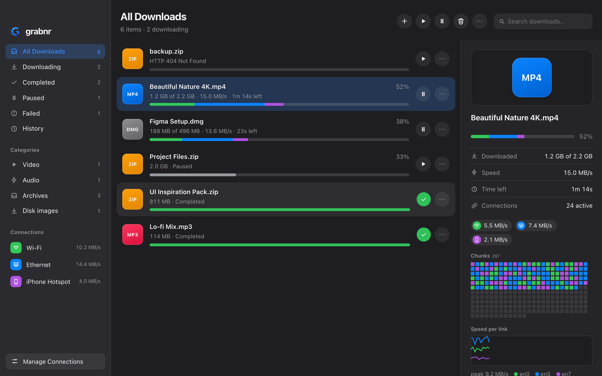

<p align="center"></p>

Download faster by using every network connection at once: Wi-Fi, Ethernet, USB or phone tethering.
Files are split into chunks, and a worker bound to each interface pulls chunks from a shared queue,
so faster links take more chunks.

**Website and downloads: https://rokib16x.github.io/grabnr/** (source in `site/`).

Built with Tauri 2 and Rust (small installer, low memory). Developed on macOS; Linux and Windows builds are produced too (see Platforms).

<p align="center"></p>

## Install

Download the latest release from the [Releases page](https://github.com/rokib16x/grabnr/releases/latest) or the [website](https://rokib16x.github.io/grabnr/):

| | File |
|---|---|
| macOS (Apple Silicon / Intel) | `grabnr_<version>_aarch64.dmg` / `grabnr_<version>_x64.dmg` |
| Windows (x64) | `grabnr_<version>_x64-setup.exe` or `.msi` |
| Windows on Arm | `grabnr_<version>_arm64-setup.exe` |
| Linux (x64 / Arm) | `.AppImage`, `.deb` or `.rpm` (`amd64`/`x86_64` or `arm64`/`aarch64` in the name) |
| Command line only | `grabnr-macos-arm64.tar.gz`, `grabnr-macos-x86_64.tar.gz`, `grabnr-linux-x86_64.tar.gz`, `grabnr-linux-arm64.tar.gz`, `grabnr-windows-x86_64.zip` |
| Browser extension | `grabnr-chrome.zip` (Chrome, Brave, Edge) or `grabnr-firefox.zip` |

macOS releases are signed with a Developer ID and notarized by Apple, and the app updates itself from Preferences.

## How it works

1. grabnr finds every usable link (Wi-Fi, Ethernet, USB or phone tethering) and skips VPN tunnels.
2. The file is split into 1-8 MB chunks in one shared queue.
3. Each link gets its own connections, bound to that interface (`IP_BOUND_IF` on macOS), so traffic really leaves through it instead of the default route.
4. Every connection takes the next chunk as soon as it finishes the last one. Nobody assigns the work: a faster link comes back sooner, so it ends up taking more.
5. Near the end, the slowest chunk is fetched again on a faster link (tail racing) and the first copy wins, so one slow link cannot hold up the whole file.
6. Links can join or leave mid-download (Wi-Fi after sleep, a cable plugged in), and a server that throttles a link with 429/503 gets that link backed off, not the whole download.

## Layout

| Path | What |
|---|---|
| `crates/grabnr-core` | Engine: interface discovery, binding (`IP_BOUND_IF`), transfers |
| `crates/grabnr-cli` | `grabnr` CLI built on the same engine |
| `src-tauri` | Tauri app: download manager, queue, local API for the browser extension |
| `src` | React + TypeScript UI (download list, chunk grid, per-link speed graph, settings) |
| `extension` | Chrome/Brave/Edge and Firefox extension that hands browser downloads to the app |
| `FEATURES.md` | Full feature list |

## Status

Built and tested (see [FEATURES.md](FEATURES.md) for the full list):
- **Engine:** shared chunk queue over every link, tail racing, adaptive connections per link, resume across restarts, retries with backoff, throttle handling, mirrors and Metalink, checksums, speed limits, proxies and sign-in, links that join or leave mid-download, recovery from stalled connections.
- **App:** macOS-style window with a sidebar, categories, inspector, chunk map and per-link speed graph; menu bar popover; history and statistics; onboarding; command palette; Dock progress.
- **Protocols:** HTTP/HTTPS, FTP and SFTP split over every link; HLS video-on-demand with a quality choice; BitTorrent and magnet links (download only). Torrent peers are spread over all your links, even for a single file.
- **Queue:** concurrent download limit, priorities, time-of-day schedule, shared and per-link speed limits.
- **Browser extension** for Chrome, Brave, Edge and Firefox. Safari: context menu only (Safari has no downloads API).
- **Releases:** signed and notarized macOS builds with auto-update; Windows and Linux installers.

Not done yet: live HLS streams and DASH, torrent seeding, IPv6 binding, resuming from servers without range support, a Share Sheet extension.

## Help test the speed-up

**This is the one thing not yet proven on real hardware:** that bandwidth adds up across two links with different gateways. The engine is tested against a local range server and the interface binding is checked by `grabnr spike`, but nobody has yet measured the speed-up on two physical connections from different ISPs.

If you have two connections (say home broadband plus a phone hotspot), you can help. The `grabnr` CLI is in the `grabnr-<os>-<arch>.tar.gz` / `.zip` release files (see Install):

```bash
grabnr spike --secs 8
```

Then download one large file with only one link enabled, and again with both, and [open an issue](https://github.com/rokib16x/grabnr/issues/new) with the `spike` output and both times. `Bound` in the spike output means traffic really left through that link; `SameEgress` means the same ISP, or the OS ignored the binding.

## Building it yourself

A build you make yourself is not signed, so macOS refuses to open it the first time. Control-click it, choose
**Open**, then **Open** again (details in [docs/RELEASING.md](docs/RELEASING.md)).

## Platforms

| | macOS | Linux | Windows |
|---|---|---|---|
| Keeps a download on its connection | `IP_BOUND_IF` (strong) | `SO_BINDTODEVICE` (strong) | by source address; works when each adapter has its own router |
| Menu bar / tray popover | yes | tray menu (Linux trays send no click events) | yes |
| Translucent sidebar, Dock progress, Quick Look thumbnails, Keychain, quarantine flag | yes | no | no |
| Tested in CI | build, tests, UI | build, clippy, tests | build, tests |

Run `grabnr spike` on any system to see whether traffic really leaves through each connection.

## Develop

```bash
npm install
npm run tauri dev        # the desktop app
npm run check            # UI type-check and tests, extension harness
cargo test --workspace   # engine, CLI and app tests
cargo clippy --workspace --all-targets -- -D warnings
cargo fmt --all
```

## CLI

```bash
cargo run -p grabnr-cli -- links
cargo run -p grabnr-cli -- get https://proof.ovh.net/files/100Mb.dat -o ~/Downloads
cargo run -p grabnr-cli -- get URL --only en0,en5 --limit 20 --checksum sha256:<hex>
cargo run -p grabnr-cli -- get URL --mirror https://mirror.example/file --proxy socks5://127.0.0.1:1080
cargo run -p grabnr-cli -- get https://example.org/file.meta4   # a Metalink file adds its mirrors and hash
cargo run -p grabnr-cli -- get https://example.org/video.m3u8 --quality 720   # a streaming video, split over every link
cargo run -p grabnr-cli -- get ftp://ftp.gnu.org/gnu/hello/hello-2.12.1.tar.gz   # FTP, split over every link
cargo run -p grabnr-cli -- get sftp://user@host/path/file.iso    # SFTP (password in the link, or a key via the app's settings)
cargo run -p grabnr-cli -- get 'magnet:?xt=urn:btih:...'      # torrents: peers are spread over your links, even for one file
cargo run -p grabnr-cli -- spike --secs 8
```

The spike reports the public IP seen through each link in each bind mode.
`Bound` means egress differs from the default route. `SameEgress` means the same ISP, or the bind was ignored.
Proving that bandwidth adds up needs two links with different gateways.

## Browser extension

Load `extension/` unpacked (see `extension/README.md`). No pairing: grabnr trusts the extension by its fixed ID.
Downloads started in the browser are sent to grabnr and the browser copy is cancelled. If grabnr is not running, the browser downloads normally.
The app listens on `127.0.0.1:17653` only, refuses requests from web pages, and accepts `/add` only from the official extension's ID or with a token.
